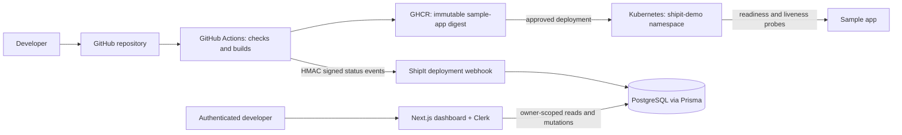

# ShipIt architecture

ShipIt separates its control plane from the application it deploys. The Next.js
dashboard never receives Kubernetes credentials. GitHub Actions builds the
controlled sample app, publishes it to GHCR, and deploys it after the GitHub
`production` Environment approval gate.

## Data and authorization

- `Project.ownerId` stores the Clerk user ID. Project queries and mutations
  include that ID in their database filter; Clerk identity alone is not treated
  as project authorization.
- A project has one optional GitHub repository, up to one environment of each
  type, deployments, and audit records.
- A deployment is identified for retries by project, environment, and workflow
  run ID. Its deployment events have a unique external event ID. The event
  transaction stores duplicate deliveries once and only advances status for a
  newer, valid transition.
- Environment configuration stores deployment targets and secret-store
  references. Runtime secrets stay in environment variables or Kubernetes
  Secrets and are never written into ordinary project configuration fields.

## Deployment trust boundary

The public webhook verifies HMAC-SHA256 against the exact request body before
parsing it. GitHub Actions uses stable event IDs for a run attempt and sends
`RUNNING` followed by a terminal result. Kubernetes credentials are held by the
GitHub `production` Environment, which can require reviewers; they are not
available to the dashboard. The sample-app pod runs as a non-root user, drops
Linux capabilities, has resource limits, and does not mount a service account
token.

The ShipIt dashboard image and sample-app image are published separately. The
production deployment consumes the sample-app image by digest so a mutable tag
cannot change what an approved workflow deploys.

## Local and demo paths

- `docker compose up --build` runs ShipIt with PostgreSQL for local dashboard
  work. Apply database migrations explicitly as documented in the README.
- The sample app can be run as a container from `examples/sample-app` and is
  the only application targeted by `deploy/kubernetes/deploy.sh`.
- Kubernetes exposes the sample app internally through a ClusterIP service.
  Use `kubectl port-forward` for a local demo; public ingress and TLS are
  intentionally not provisioned by these manifests.
- To recover a failed sample-app rollout, use
  `kubectl -n shipit-demo rollout undo deployment/sample-app` and inspect the
  rollout status and ShipIt event timeline.

## Known MVP limits

- Kubernetes health is checked by startup, readiness, and liveness probes;
  ShipIt records the verified rollout result rather than polling the private
  cluster from the dashboard.
- Rollback recovery uses Kubernetes' previous ReplicaSet. A rollback request
  recorded from the dashboard does not itself call the cluster; execute the
  documented `kubectl rollout undo` command using the approved operator
  workflow.
- PostgreSQL is external to the Kubernetes sample-app namespace. Compose is
  for local development, not a production database deployment.
